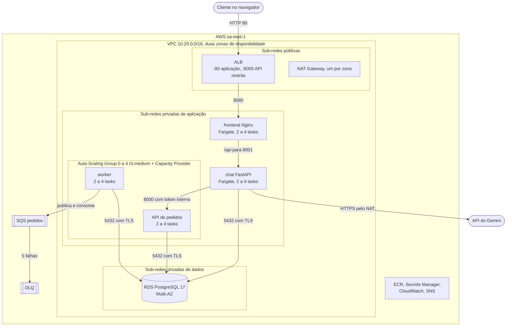

# Guia para o vídeo de entrega: Terraform e infraestrutura

Apoio para gravar o vídeo do projeto final (10 a 15 minutos, seis etapas na
ordem do enunciado). Explica como o Terraform funciona, como executá-lo e o que
mostrar e dizer em cada etapa. O detalhe de cada comando de teste está em
[`terraform/README.md`](../terraform/README.md).

Os nomes abaixo usam o prefixo padrão `insper-eats-sp` (região `sa-east-1`).

## 1. Antes de gravar

O código passou em validação estática, em 16 testes com provider simulado e num
ensaio local em Docker. **Ele ainda não foi aplicado numa conta AWS real.** O
primeiro `./deploy.sh` do grupo é o teste que falta, e precisa acontecer com
folga antes da gravação.

- [ ] Rodar `./deploy.sh` e `python3 scripts/verify_deploy.py` sem falhas.
- [ ] Rodar `terraform plan -detailed-exitcode` logo depois: deve sair com
      código 0 (nenhuma mudança pendente).
- [ ] Fazer uma compra pelo chat com a IA real e ver o pedido virar
      "confirmado".
- [ ] Desenhar o diagrama final. A etapa 3 do roteiro traz uma base.
- [ ] Decidir quem narra cada etapa. Todos precisam falar, e o professor pode
      arguir qualquer integrante sobre qualquer parte.
- [ ] Gravar as etapas 2 e 4 com o ambiente ligado; destruir depois.

O ambiente ligado custa na ordem de US$ 13 a 15 por dia. O número é uma
estimativa minha, confira na calculadora da AWS. Suba, grave e destrua.

## 2. Como executar

O enunciado exige que o Terraform crie a infraestrutura completa sem
intervenção manual. O fluxo é um comando, sem perguntas:

```bash
cd terraform
aws sso login --profile insper-eats && export AWS_PROFILE=insper-eats
read -rs TF_VAR_gemini_api_key && export TF_VAR_gemini_api_key   # digite a chave; ela não aparece
./deploy.sh
```

Pré-requisitos na máquina: Terraform 1.11 ou mais novo, AWS CLI v2, Docker em
execução, Python 3 e bash.

O que `deploy.sh` faz, em ordem:

1. Confere ferramentas, Docker e credenciais; mostra a conta AWS.
2. Cria o bucket S3 do state remoto (`bootstrap/`) e gera `backend.hcl`.
3. Roda `terraform init` com esse backend e `terraform apply`.

Leva de 25 a 35 minutos. No fim, imprime a URL da aplicação. Repetir o comando
é seguro: só aplica o que mudou.

Depois:

```bash
python3 scripts/verify_deploy.py     # confere AWS e aplicação; grava relatório em evidencias/
terraform output                     # URLs, nomes e ARNs para navegar no console
terraform destroy                    # ao final da gravação
```

Para alcançar a API de pedidos em `http://<alb>:8000` (documentação e testes),
copie `terraform.tfvars.example` para `terraform.tfvars` e ponha seu IP em
`api_allowed_cidrs`.

Duas coisas continuam fora do Terraform por natureza: obter a chave do Gemini
no Google AI Studio e, se `alert_email` for usado, clicar no link de
confirmação que a AWS envia.

## 3. Como o Terraform funciona

### O que acontece durante o apply

O Terraform monta um grafo de dependências e cria em paralelo o que for
independente. Na prática, a ordem é esta:

| Fase | O que é criado | Por que nessa ordem |
| --- | --- | --- |
| 1 | VPC, sub-redes, IGW, NAT, rotas, security groups, repositórios ECR, filas SQS, papéis IAM | não dependem de nada |
| 2 | Build e push das 4 imagens (`scripts/build-push.sh`) | precisam dos repositórios |
| 3 | RDS PostgreSQL (10 a 20 min) e os secrets com as URLs de conexão | a URL precisa do endpoint do banco |
| 4 | Cluster ECS, launch template, Auto Scaling Group (em zero), Capacity Provider, ALB, Cloud Map | base para os serviços |
| 5 | Task `db-init` em Fargate (`scripts/run-db-init.sh`) | precisa do banco, dos secrets, da imagem e do NAT |
| 6 | Os 4 serviços ECS; o Capacity Provider sobe 2 instâncias EC2 | só depois do banco pronto |
| 7 | Auto scaling, alarmes e dashboard | referenciam os serviços |

O apply só termina quando os quatro serviços estão estáveis
(`wait_for_steady_state`). Se uma task não sobe, o apply falha.

### Onde está cada coisa

| Arquivo | Conteúdo |
| --- | --- |
| `versions.tf` | versão do Terraform, providers, backend S3 e região |
| `variables.tf` | todos os parâmetros, com padrão e descrição |
| `network.tf` | VPC, 6 sub-redes, NAT por AZ, rotas, endpoints S3 e SQS |
| `security.tf` | 9 security groups e suas regras |
| `database.tf` / `secrets.tf` | RDS e os 4 secrets de aplicação |
| `messaging.tf` | fila de pedidos e DLQ |
| `ecr.tf` | repositórios e publicação das imagens |
| `ecs_cluster.tf` | cluster, launch template, ASG, Capacity Provider |
| `alb.tf` | ALB, target groups, listeners |
| `db_init.tf` + `files/db_init.py` | preparação do banco |
| `ecs_services.tf` + `modules/ecs-service/` | os 4 serviços e seu auto scaling |
| `observability.tf` | SNS, alarmes, dashboard |
| `bootstrap/` | bucket do state remoto |

### Pontos que valem explicar

**Região e parâmetros.** Tudo depende de `var.region` (padrão `sa-east-1`).
Nada regional está fixo no código:

- as zonas vêm de `data "aws_availability_zones"`, porque os nomes de Ohio não
  existem em São Paulo;
- a AMI vem do parâmetro público
  `/aws/service/ecs/optimized-ami/amazon-linux-2023/recommended/image_id`, que
  tem um valor por região;
- as imagens são reconstruídas e enviadas ao ECR da região de destino;
- endpoints de VPC usam `com.amazonaws.${var.region}.<serviço>`.

O sufixo `environment` (`sp`) entra em todos os nomes. Papéis IAM são globais
na conta, então é ele que evita colisão com os recursos manuais de Ohio.

**Backend remoto.** O state fica num bucket S3 versionado, criptografado, sem
acesso público e com lock nativo (`use_lockfile`), que impede dois applies
simultâneos. O bucket é criado por `bootstrap/` porque o backend precisa
existir antes do `terraform init` do ambiente.

**Segredos fora do state.** As senhas dos usuários do banco e o token interno
são gerados por recursos efêmeros e gravados no Secrets Manager por argumentos
write-only. A chave do Gemini entra por uma variável efêmera. Nenhum desses
valores aparece no plan, no state ou nos outputs:

```hcl
ephemeral "random_password" "db_app" {
  length  = 40
  special = false
}

resource "aws_secretsmanager_secret_version" "database_url" {
  secret_id                = aws_secretsmanager_secret.database_url.id
  secret_string_wo         = "postgresql+psycopg://${local.db_app_user}:${ephemeral.random_password.db_app.result}@${local.db_endpoint}/${local.db_name}?sslmode=require"
  secret_string_wo_version = var.credentials_version
}
```

A senha do administrador do RDS é criada e girada pelo próprio RDS
(`manage_master_user_password`). As tasks recebem os valores por `secrets` na
task definition, que guarda só o ARN.

**Imagens.** A tag de cada imagem é um hash dos arquivos que entram no build.
Código igual gera a mesma tag e nada é reconstruído; código alterado gera uma
tag nova, uma nova revisão da task definition e um rolling deployment.

**Preparação do banco.** A task `db-init` é a única que recebe a credencial de
administrador. Ela cria `insper_app` e `insper_chat`, o banco exclusivo do
chat, as permissões (cada usuário só conecta no próprio banco), as tabelas da
API e o catálogo inicial (`seed_products`, só em banco vazio).

**Módulo reutilizado.** `modules/ecs-service` cria, para cada serviço, log
group, execution role, task role, task definition, serviço e auto scaling. Os
quatro serviços são quatro chamadas desse módulo com parâmetros diferentes.

## 4. Roteiro por etapa

### Etapa 1: startup e proposta de valor (1min30s)

Conteúdo do grupo; a infraestrutura não entra aqui. O enunciado pede nome,
produto, problema, público-alvo, proposta de valor, diferenciais, receita e
escalabilidade. O que o próprio produto já diz: Insper Eats, "seu intervalo,
mais gostoso", pedido de lanche no campus por conversa com um vendedor de IA.

### Etapa 2: demonstração real (2min)

Com `ai_provider = "gemini"` e a chave configurada:

1. Abrir a URL de `terraform output app_url`.
2. Perguntar em linguagem natural o que há para comer. A resposta vem do
   catálogo real (tabela `produto` no RDS, lida pela API).
3. Pedir um item, informar nome e local de entrega, e clicar em confirmar.
4. Mostrar o pedido no painel passando de "recebido" para "confirmado" em
   cerca de 10 segundos. Essa mudança é o worker processando a mensagem do SQS.
5. Comprovar a persistência: recarregar a página (o pedido continua lá) e, se
   couber, mostrar a linha `Pedido N confirmado` no log do worker
   (`aws logs tail /ecs/insper-eats-sp/worker --since 5m`).

O enunciado recusa conversa simulada. O modo `commands` serve para testes
automáticos, não para o vídeo. Use nomes fictícios: a conversa vai para o
Gemini.

### Etapa 3: diagrama de arquitetura (2min)

Base fiel ao que o Terraform cria (o GitHub renderiza este bloco):



Caminho de um pedido, para narrar sobre o diagrama:

1. O navegador chama o ALB na porta 80; o ALB entrega ao Nginx do frontend.
2. O Nginx serve a interface e encaminha `/api/*` ao chat, que ele encontra por
   DNS interno (`chat.insper-eats-sp.internal`, Cloud Map).
3. O chat consulta o Gemini (saída pelo NAT) e a API de pedidos
   (`api.insper-eats-sp.internal:8000`), enviando `X-Internal-Token`.
4. Na confirmação, a API grava pedido, itens, baixa de estoque e um evento de
   outbox numa única transação no RDS. Essa parte é síncrona.
5. O worker lê o outbox, publica `pedido.criado` no SQS, consome a mensagem e
   muda o pedido para "confirmado". Essa parte é assíncrona.
6. Mensagem que falha 5 vezes vai para a DLQ e dispara um alarme.

Fora do caminho do pedido: ECR guarda as imagens, Secrets Manager entrega
credenciais às tasks, CloudWatch recebe logs e métricas, SNS envia os alarmes.

### Etapa 4: navegação pelo console (2min30s)

Região São Paulo. Para cada item: o que é, para que serve aqui e a quem se liga.

| Console | Recurso | O que mostrar e dizer |
| --- | --- | --- |
| VPC > Sub-redes | `insper-eats-sp-public-1/2`, `-app-1/2`, `-data-1/2` | três camadas em duas zonas |
| VPC > Tabelas de rotas | `-public-rt`, `-app-rt-1/2`, `-data-rt` | pública sai pelo IGW; aplicação, pelo NAT da própria zona; dados não têm saída |
| VPC > Security groups | `-alb-sg`, `-frontend-sg`, `-chat-sg`, `-api-sg`, `-worker-sg`, `-rds-sg` | abrir o `-rds-sg` e mostrar que a origem das regras são outros grupos, não IPs |
| EC2 > Load balancers | `insper-eats-sp-alb` | listeners 80 e 8000; sub-redes públicas |
| EC2 > Target groups | `-frontend-tg`, `-api-tg` | tipo `ip`, 2 targets healthy, health check `/healthz` e `/health` |
| ECS > Clusters | `insper-eats-sp-cluster` | 4 serviços com 2/2 tasks; aba Infraestrutura mostra o Capacity Provider e as 2 instâncias |
| ECS > serviço `-api-service` | tasks e configuração | placement: spread por zona, binpack por memória, `distinctInstance` |
| ECS > Task definitions | `insper-eats-sp-api` | variáveis sensíveis aparecem como ARN de secret, não como valor |
| EC2 > Auto Scaling groups | `insper-eats-sp-ecs-asg` | mínimo 0, máximo 4; proteção de scale-in; quem define o desejado é o Capacity Provider |
| ECR | `insper-eats-sp-api`, `-worker`, `-chat`, `-frontend` | tags imutáveis, derivadas do hash do código |
| RDS | `insper-eats-sp-postgres` | Multi-AZ, não público, criptografado, backups de 7 dias |
| SQS | `insper-eats-sp-orders`, `-orders-dlq` | política de redrive com 5 recebimentos |
| IAM > Funções | `-api-execution-role`, `-worker-task-role` | execution role lê só os secrets do serviço; a task role do worker só acessa a fila de pedidos |
| Secrets Manager | `insper-eats-sp/database-url` e os outros 3 | mostrar a lista e os metadados; **não clicar em "Recuperar valor do segredo"** |
| CloudWatch > Painéis | `insper-eats-sp-observabilidade` | 14 widgets |
| CloudWatch > Alarmes | 14 alarmes `insper-eats-sp-*` | todos OK; ação: tópico SNS `-alertas` |
| CloudWatch > Grupos de logs | `/ecs/insper-eats-sp/worker` | linha de confirmação do pedido da etapa 2 |

`terraform output` lista URLs, nomes e ARNs para chegar rápido a cada tela.

### Etapa 5: conceitos e decisões (3min30s)

O enunciado pede exemplos concretos, não definições. Um trecho por tema:

**Rede e comunicação** (`security.tf`). As regras apontam para grupos, não para
faixas de IP. Só fica aberto o caminho internet → ALB → frontend → chat → API →
RDS.

```hcl
resource "aws_vpc_security_group_ingress_rule" "rds_from_clients" {
  for_each = local.database_clients   # api, worker, chat, db_init

  security_group_id            = aws_security_group.rds.id
  description                  = "PostgreSQL a partir de ${each.key}"
  referenced_security_group_id = each.value
  ip_protocol                  = "tcp"
  from_port                    = 5432
  to_port                      = 5432
}
```

Para falar: só o ALB e os NAT ficam em sub-rede pública; nenhuma task tem IP
público; o tráfego interno usa DNS privado (Cloud Map); o worker fala com o SQS
por um endpoint de VPC.

**Containers e elasticidade** (`modules/ecs-service/main.tf`, `ecs_cluster.tf`).

```hcl
dynamic "ordered_placement_strategy" {
  for_each = local.is_ec2 ? [
    { type = "spread", field = "attribute:ecs.availability-zone" },
    { type = "binpack", field = "memory" },
  ] : []

  content {
    type  = ordered_placement_strategy.value.type
    field = ordered_placement_strategy.value.field
  }
}

dynamic "placement_constraints" {
  for_each = local.is_ec2 ? [1] : []

  content {
    type = "distinctInstance"
  }
}
```

Os blocos são `dynamic` porque o mesmo módulo atende Fargate, que não aceita
placement. O trecho seguinte é do Capacity Provider.

```hcl
managed_scaling {
  status                    = "ENABLED"
  target_capacity           = 100
  minimum_scaling_step_size = 1
  maximum_scaling_step_size = 2
  instance_warmup_period    = 300
}
```

Para falar: há dois níveis de escala. O Application Auto Scaling muda o número
de tasks (API por CPU a 60%; worker por backlog, 5 mensagens por task). Quando
uma task não acha lugar, o Capacity Provider aumenta o Auto Scaling Group; quando
sobra instância vazia, ele reduz. O ASG nunca é ajustado à mão. Health checks
existem em três pontos: contêiner (ECS), target group (ALB) e instância (ASG).

**Por que chat e frontend estão em Fargate.** Uma t3.medium tem 3 interfaces de
rede, o que dá 2 tasks `awsvpc` por instância. Essas vagas são da API e do
worker. Colocar os serviços novos em EC2 dobraria o número de instâncias em
repouso; em Fargate eles não disputam vagas. API e worker continuam em ECS
sobre EC2, que é o modelo exigido e o que foi validado em Ohio.

**Dados, mensageria e segurança** (`messaging.tf`, `ecs_services.tf`).

```hcl
redrive_policy = jsonencode({
  deadLetterTargetArn = aws_sqs_queue.orders_dlq.arn
  maxReceiveCount     = 5
})
```

Para falar:

- O caminho chat, API e RDS é síncrono. O caminho outbox, SQS e worker é
  assíncrono.
- O outbox garante que pedido e evento são gravados juntos; nenhum evento se
  perde entre o commit e a publicação.
- SQS Standard entrega pelo menos uma vez. Duplicidade é tratada em dois
  lugares: chave de idempotência na API e verificação de status no worker.
- O worker só apaga a mensagem depois de processá-la. Se falhar, ela volta à
  fila em 60 segundos, e na quinta falha vai para a DLQ.
- Cada serviço tem dois papéis IAM. A execution role é do ECS (puxar imagem,
  gravar log, ler secret). A task role é do código; só o worker tem permissões,
  restritas à fila de pedidos.

**Terraform e compromissos.** Usar os pontos da seção 3 e esta tabela:

| Decisão | Ganho | Custo |
| --- | --- | --- |
| NAT por zona | saída sobrevive à perda de uma zona | dois NAT ligados |
| RDS Multi-AZ | failover automático do banco | dobro do custo da instância |
| ASG começando em zero, gerido pelo Capacity Provider | paga só pelas instâncias em uso | primeira subida e deploys levam minutos |
| `distinctInstance` | perder uma EC2 nunca derruba um serviço | deploy precisa de instância extra temporária |
| API fora da porta 80, restrita por IP | `/produtos` sem autenticação não fica exposto | testes exigem liberar o IP |
| Sem HTTPS por padrão | funciona sem domínio próprio | tráfego em claro até informar certificado e domínio |

### Etapa 6: falhas, riscos e recuperação (2min)

| Falha | Impacto | Como se detecta | Recuperação | Situação |
| --- | --- | --- | --- | --- |
| Task interrompida | nenhum para o cliente, a outra réplica atende | alarme `*-tasks-low`, eventos do serviço | ECS cria outra em cerca de 1 minuto | automática |
| Perda de uma EC2 | capacidade cai à metade por minutos | alarmes de tasks e de targets | ASG substitui a instância; ECS recoloca as tasks | automática |
| Deploy com defeito | nenhum, a versão antiga segue no ar | eventos do serviço | circuit breaker desfaz o deployment | automática |
| Zona indisponível | capacidade reduzida; conexões ao banco caem, em geral por 1 a 2 minutos | alarmes de targets, eventos do RDS | ALB usa a outra zona; RDS promove a réplica; ASG repõe na zona restante | automática |
| Mensagem que sempre falha | um pedido fica sem confirmação | alarme `dlq-messages`, log do worker | corrigir a causa e reenviar da DLQ | detecção automática, correção manual |
| Dado apagado ou corrompido | perda de pedidos até a restauração | relato ou inconsistência; não há alarme | restaurar o RDS para um instante dos últimos 7 dias, em nova instância | manual, não ensaiada |
| Gemini fora do ar | chat responde erro; pedidos já feitos seguem | erros 503 no log do chat | aguardar o provedor | sem contingência |
| Região indisponível | plataforma inteira fora do ar | fora da AWS; os alarmes ficam na mesma região | ver abaixo | proposta |

**Desastre regional.** O Terraform é parametrizado por região. Num clone limpo
do repositório, o comando abaixo cria outro bucket de state e recria a
infraestrutura vazia em outra região, em cerca de 30 minutos:

```bash
TF_VAR_region=us-east-1 TF_VAR_environment=dr ./deploy.sh
```

O clone precisa ser limpo porque `bootstrap/` guarda um state local que aponta
para o bucket de São Paulo. Esse procedimento nunca foi ensaiado.

Os dados não acompanham. Os backups do RDS, as imagens e o próprio state ficam
em São Paulo. Hoje, um desastre regional significa esperar a região voltar ou
recomeçar sem pedidos e com o catálogo inicial.

Melhorias, em ordem de prioridade para uma startup real:

1. Replicar os backups do RDS para outra região.
2. Replicar o bucket do state e as imagens do ECR.
3. Ensaiar a restauração do banco e medir o tempo.
4. HTTPS com domínio próprio e DNS com failover (Route 53).
5. Migrações versionadas e autenticação na API.

**Resposta à pergunta obrigatória.** A plataforma tem alta disponibilidade
dentro de uma região: falhas de task, de instância, de zona e do banco se
recuperam sozinhas, em minutos e sem perda de dados. Ela não tem recuperação de
desastres completa: contra a perda da região ou a corrupção de dados, o que há
é a capacidade de recriar a infraestrutura por código e backups locais de 7
dias, com restauração manual. Alta disponibilidade mantém o serviço no ar
apesar de falhas de componentes; recuperação de desastres devolve o serviço e
os dados depois que tudo falhou, com tempo e perda máxima definidos e testados.

## 5. Cuidados na gravação

- Definir a chave do Gemini com `read -rs` e nunca dar `echo` nela.
- No Secrets Manager, mostrar só lista e metadados.
- Não abrir `terraform.tfvars` na tela se tiver IP ou e-mail.
- Não mostrar o token interno; para chamar a API em `:8000`, usar `/docs` ou
  `/produtos`, que não pedem token.
- Usar nomes e endereços fictícios nos pedidos.
- Cortes são permitidos (o apply de 30 minutos, por exemplo), desde que não
  simulem algo que não existe.

## 6. Perguntas prováveis na arguição

- **Por que o ASG tem mínimo zero?** Quem define a quantidade é o Capacity
  Provider, a partir das tasks; as 2 instâncias em repouso existem porque há 2
  réplicas com `distinctInstance`.
- **O que acontece se dois clientes compram o último item?** A API usa
  `SELECT ... FOR UPDATE`; um recebe 201 e o outro 409.
- **E se a mesma mensagem chegar duas vezes?** O worker vê o pedido já
  confirmado e ignora.
- **Onde está a senha do banco?** No Secrets Manager. Não está no código, no
  state, nas variáveis de ambiente em texto claro nem nos logs.
- **Como o frontend acha o chat?** Por DNS privado do Cloud Map, resolvido de
  novo a cada 10 segundos.
- **O que muda para subir em outra região?** Só `var.region` e, na mesma conta,
  `var.environment`, com um state separado.
- **Por que dois applies (bootstrap e ambiente)?** O backend S3 precisa existir
  antes do `init`; `deploy.sh` encadeia os dois.
- **Por que a API está na porta 8000?** `/produtos` não tem autenticação; a
  porta só abre para IPs autorizados.
